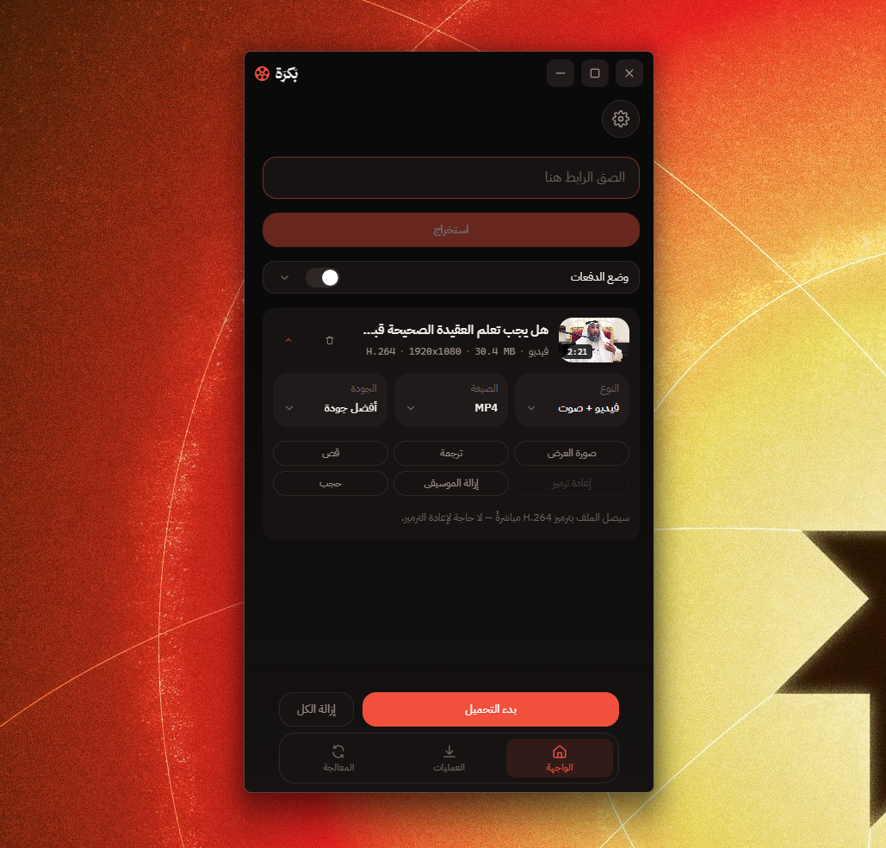

<div align="center">

# بَكرَة

**من ممنتج إلى الممنتجين — مادة خام جاهزة للتايم لاين**

[](https://github.com/iMait00/bakara/releases/latest)
[](https://github.com/iMait00/bakara/releases)


### [⬇️ حمّل آخر إصدار](https://github.com/iMait00/bakara/releases/latest)



</div>

---

## المميزات

### التحميل
- 🎬 **فيديو من أي موقع** — يوتيوب ومنصات التواصل وأكثر من ألف موقع، بأعلى جودة متوفرة
- 📁 **مجلدات Google Drive كاملة** — بدون تقسيم zip وبدون توقّف بسبب حظر التحميل
- 🖼️ **منشورات الصور** — ألبومات الصور كاملة، وصورة العرض بأعلى دقة
- 🎵 **فيديو أو صوت** — تختار النوع والصيغة والجودة لكل رابط
- ✂️ **قص قبل التحميل** — تحدّد البداية والنهاية وتنزّل الجزء اللي تحتاجه بس
- 💬 **ترجمة SRT** — يقراها بريمير ودافينشي وكاب كت مباشرة
- 📋 **وضع الدفعات** — الصق روابط بعدد ما تبي، بإعدادات موحّدة، وخلّها تشتغل

### المعالجة — لملفاتك اللي على جهازك
- 🔄 **تحويل الصيغ** — فيديو وصوت وGIF، مع التحكم بالترميز والأبعاد ومعدل الإطارات وقنوات الصوت
- 📦 **ضغط لحجم محدد** — تكتب الحجم اللي تبيه والتطبيق يوصل له
- ✂️ **قص** — تختار الجزء اللي تحتاجه من الملف
- 🎚️ **إزالة الموسيقى** — يفصل الكلام عن الخلفية الموسيقية
- 🫥 **حجب** — يُخفي النساء في الفيديو بتغبيش ناعم يغطيهن كاملاً
- 🔇 **إزالة الصوت** و🌐 **تهيئة للويب** بضغطة
- 🖼️ **الصور** — تحويل صيغها وأبعادها، أو دمجها كلها في ملف PDF واحد بالترتيب اللي تبيه

> إزالة الموسيقى والحجب متوفرة في التحميل والمعالجة معاً.

### بشكل عام
- 🔔 **يشتغل بالخلفية** — أيقونة في شريط القوائم مع لوحة سريعة، والتحميل يكمل حتى لو سكّرت النافذة
- ⬆️ **يحدّث نفسه** — التطبيق وأدواته
- 🌙 **واجهة عربية بالكامل** — RTL من أول زر لآخر رسالة خطأ

---

## التحميل والتثبيت

كل الملفات في [صفحة الإصدارات](https://github.com/iMait00/bakara/releases/latest). أول تشغيل يجهّز فيه التطبيق أدواته بنفسه — خلّ الإنترنت شغّالاً وانتظر انتهاء التهيئة.

### 🪟 Windows
- **الملف:** `Bakara_x.y.z_x64-setup.exe`
- **التثبيت:** افتح الملف واتبع خطوات المثبّت.

### 🍎 macOS
- **الملف:** `Bakara_x.y.z_aarch64.dmg` لأجهزة Apple Silicon، أو `Bakara_x.y.z_x64.dmg` لأجهزة Intel
- **التثبيت:** اسحب `Bakara.app` إلى مجلد Applications.
- **ملاحظة:** التطبيق غير موقّع بشهادة Apple، فأول مرة فقط افتحه بزر الفأرة الأيمن ← **Open** ثم أكّد. لو ظهرت رسالة «التطبيق تالف»، افتح Terminal ونفّذ:
  ```bash
  xattr -cr /Applications/Bakara.app
  ```

### 🐧 Linux
- **الملف:** `Bakara_x.y.z_amd64.AppImage`، أو `.deb` لأوبونتو وديبيان، أو `.rpm` لفيدورا
- **التثبيت:** الـ AppImage يشتغل مباشرة ويحدّث نفسه؛ `.deb` و`.rpm` تُثبَّت وتتحدّث بمدير الحزم.
- **ملاحظة:** أيقونة شريط المهام تحتاج سطح مكتب يدعم AppIndicator (على GNOME: إضافة AppIndicator). نسخ `.deb` و`.rpm` تأخذ بعض أدواتها من مدير حزم التوزيعة.

### 🐧 Arch Linux
- **التثبيت:**
  ```bash
  git clone https://github.com/iMait00/bakara && cd bakara/arch && makepkg -si
  ```
- **التحديث:** من داخل المجلد نفسه: `git pull && makepkg -si`

---

## الرخصة

**© 2026 iMait00 — جميع الحقوق محفوظة.** برنامج مغلق المصدر؛ هذا المستودع يحتوي الإصدارات الجاهزة فقط.

يُمنع بدون إذن كتابي: البيع، إعادة التوزيع، التعديل، عكس الهندسة، أو استخدام اسم «بَكرَة» وهويته البصرية. التفاصيل في [LICENSE](LICENSE).

يُقدَّم البرنامج «كما هو» دون ضمان، والمستخدم وحده مسؤول عن التزامه بشروط المواقع اللي يستخدمها معها. الأدوات الخارجية مفتوحة المصدر ينزّلها التطبيق من مصادرها الرسمية وتخضع لرخصها.

<div align="center">

**صُنع بـ ❤️ بواسطة [iMait00](https://github.com/iMait00)**

</div>
